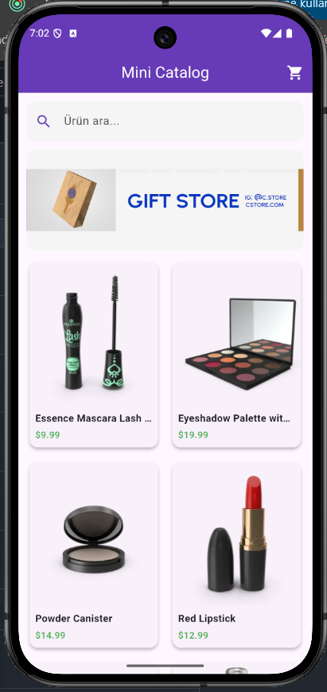
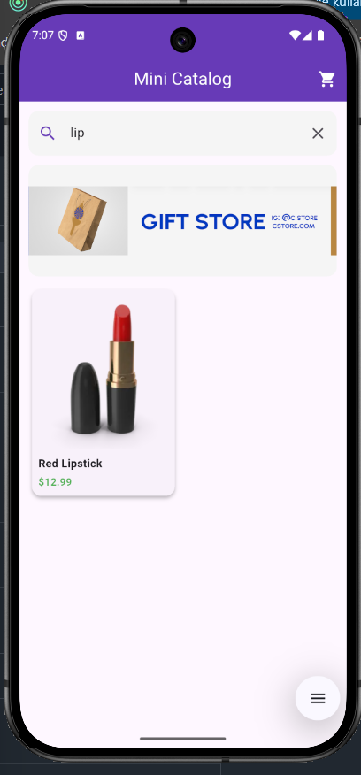
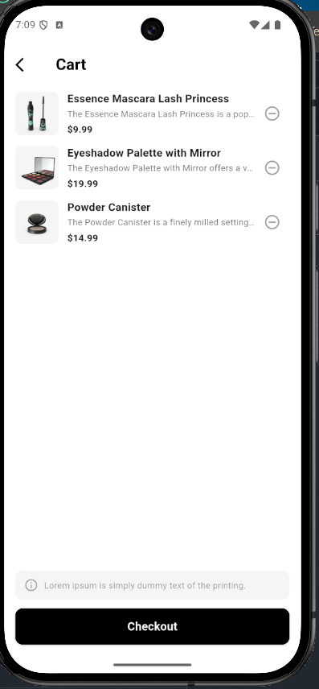
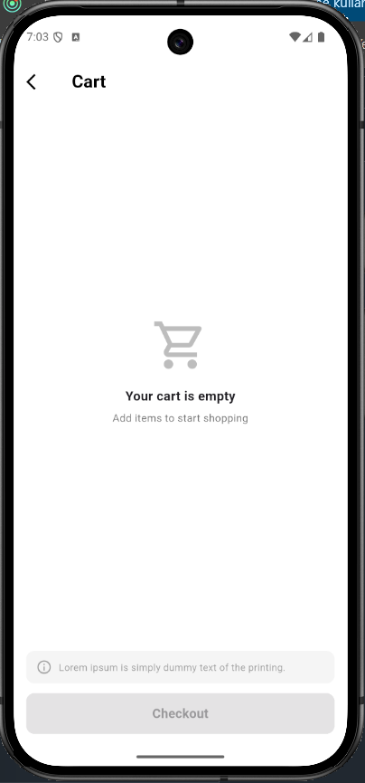

# Mini Catalog App

Software Persona Mobil bitirme projesidir.

Flutter ile Clean Architecture ve bileşen tabanlı (component-based) mimari kullanılarak geliştirilmiş modern bir e-ticaret katalog ve sepet simülasyonu uygulamasıdır.

## 📖 Kısa Açıklama

Mini Catalog, kullanıcıların ürünleri 2 sütunlu grid görünümünde listeleyebildiği, anlık arama yapabildiği, ürün detaylarını inceleyip sepete ekleyebildiği ve sepeti yönetebildiği bir mobil katalog uygulamasıdır. Sepet ve Checkout akışı simülasyon olarak çalışır; gerçek bir ödeme veya sunucu tarafı işlemi içermez.

## 📸 Ekran Görüntüleri

| Ürün Listesi | Arama | Ürün Detay |
| :---: | :---: | :---: |
|  |  |  |

| Sepete Eklendi | Dolu Sepet | Boş Sepet |
| :---: | :---: | :---: |
|  |  |  |

## 🚀 Özellikler ve Sprint Dağılımı

### Sprint 1: Temel Mimari ve UI Kurulumu

- Clean Architecture katmanlı klasör yapısı (`domain`, `data`, `presentation`).
- Temel tema ve iskelet yapılandırması.

### Sprint 2: Navigasyon ve Veri Modelleri

- `Product` entity ve model yapıları.
- Ürün listeleme ve detay sayfaları arası Navigator entegrasyonu.

### Sprint 3: Katalog, Arama, Banner ve Sepet Simülasyonu

- **Grid Görünümü (`ProductGridWidget`):** 2 sütunlu modern e-ticaret ürün listelemesi.
- **Arama ve Filtreleme:** Anlık başlık ve açıklama bazlı arama filtrelemesi.
- **Yerel Banner Entegrasyonu:** `assets/banner.png` ile öne çıkan alan tasarımı.
- **Modüler Ürün Detay Sayfası (`ProductDetailContentWidget`, `ProductActionButtonWidget`):** Fiyat, puan, açıklama ve yerel sepet state simülasyonu ("Sepete Ekle" / "Sepette").
- **Modüler Sepet Ekranı (`CartPage`):** Dolu ve boş sepet durumları (`EmptyCartWidget`, `CartListWidget`, `CartBottomSectionWidget`), ürün silme ve Checkout simülasyonu.

## 🛠️ Kullanılan Teknolojiler

- Flutter & Dart
- Clean Architecture ilkeleri
- State Management (`StatefulWidget` bazlı lokal state simülasyonu)

## 📦 Kullanılan Flutter Sürümü

- Flutter: `BURAYA_FLUTTER_SURUMU` (stable)
- Dart: `BURAYA_DART_SURUMU`

## ▶️ Çalıştırma Adımları

1. **Gereksinimler:** [Flutter SDK](https://docs.flutter.dev/get-started/install) kurulu olmalı ve bir emülatör ya da fiziksel cihaz bağlı olmalıdır.

2. **Projeyi klonlayın:**
   ```bash
   git clone https://github.com/zeyneptass/REPO_ADI.git
   cd REPO_ADI
   ```

3. **Bağımlılıkları yükleyin:**
   ```bash
   flutter pub get
   ```

4. **Ortamın hazır olduğunu kontrol edin (opsiyonel):**
   ```bash
   flutter doctor
   ```

5. **Uygulamayı çalıştırın:**
   ```bash
   flutter run
   ```
   